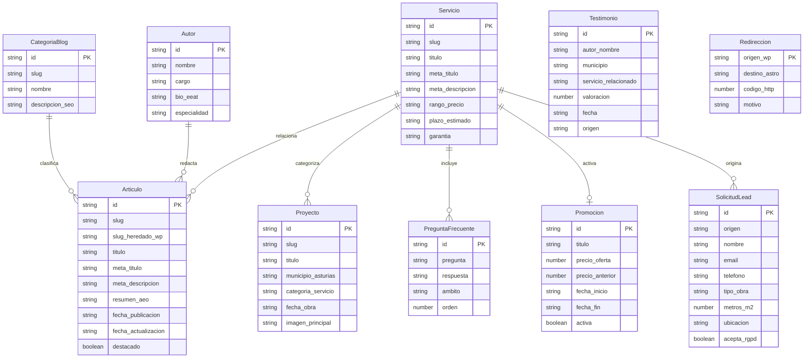

# Modelo de datos lógico

El sitio corporativo se modela alrededor de colecciones tipadas estáticas en repositorio y una entidad transaccional de entrada para solicitudes de presupuesto. Las especificaciones detalladas de cada entidad residen en `docs/09-modelo-de-datos/entidades/`.

## Catálogo de entidades
- [[Servicio]]
- [[Proyecto]]
- [[Articulo]]
- [[CategoriaBlog]]
- [[Autor]]
- [[Testimonio]]
- [[PreguntaFrecuente]]
- [[Promocion]]
- [[SolicitudLead]]
- [[Redireccion]]
